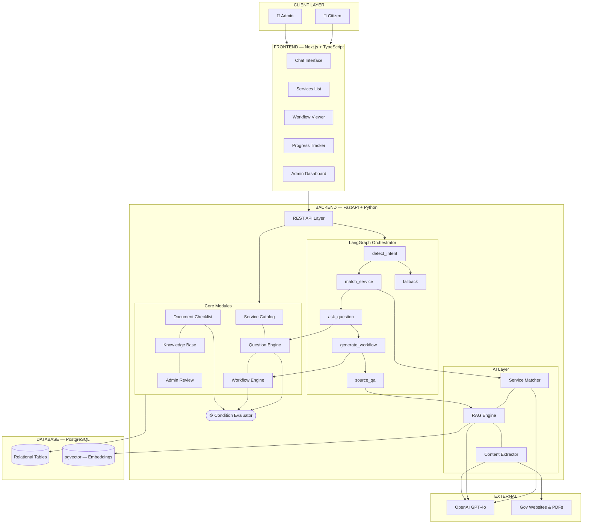
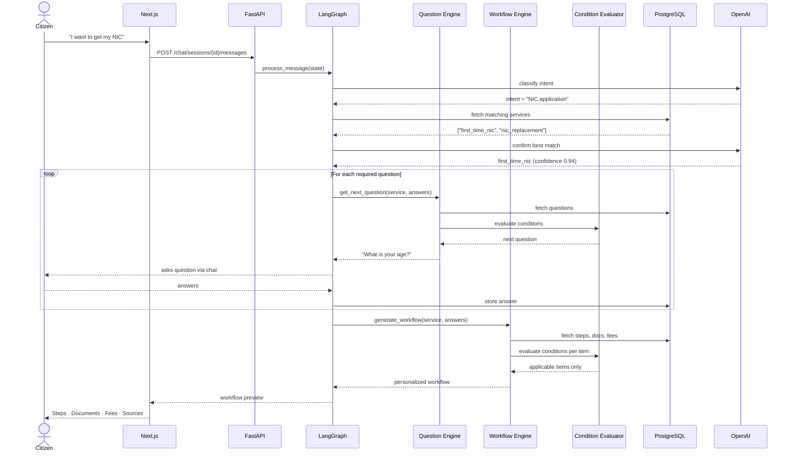
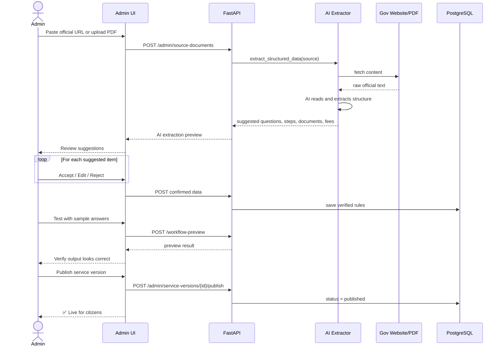
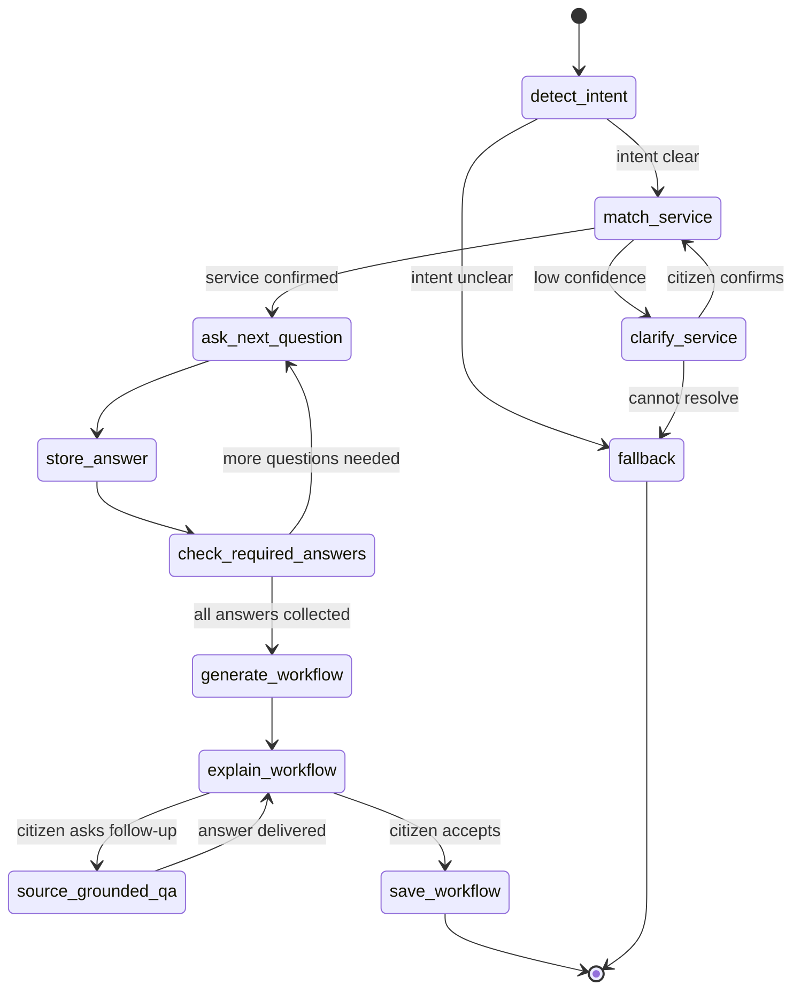
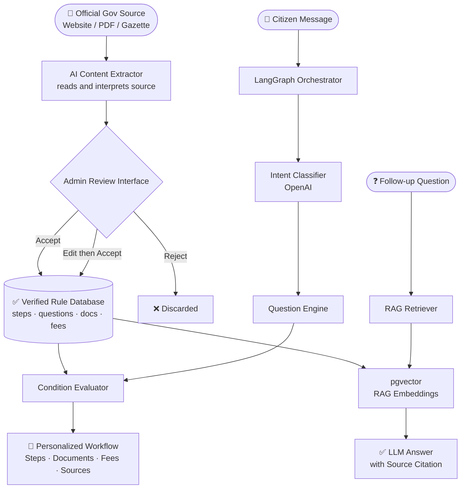
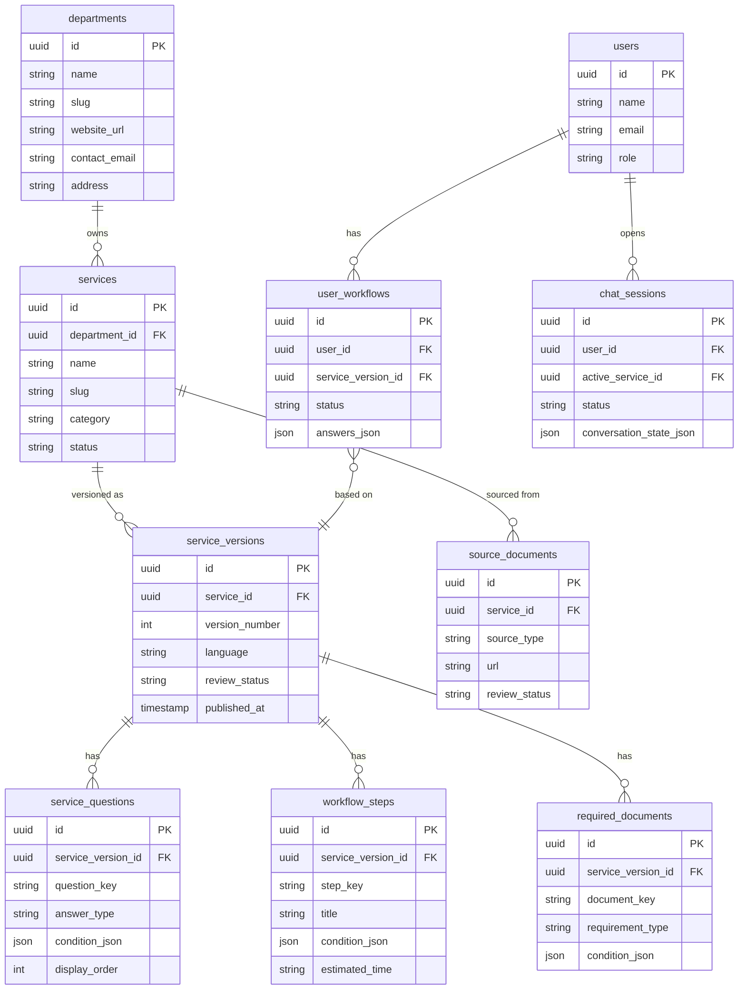
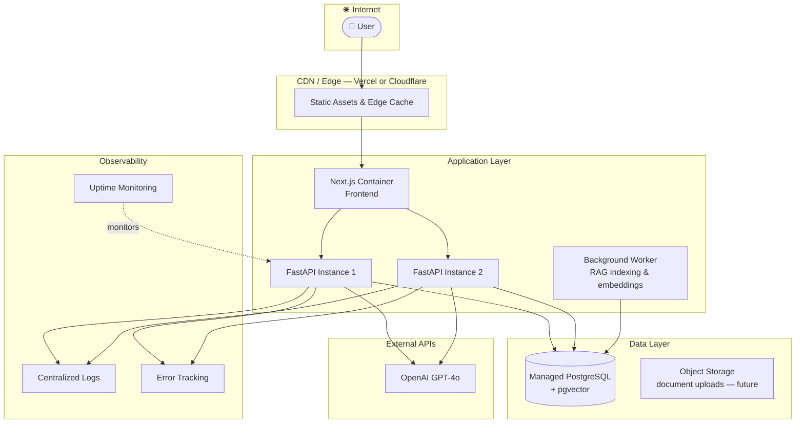

# GovFlow AI — Mermaid Diagram Collection

Paste each block at [mermaid.live](https://mermaid.live) to generate a clean image.

---

## Diagram 1 — High-Level System Architecture

---

## Diagram 2 — Citizen Chat Flow (Sequence)

---

## Diagram 3 — Admin Content Creation Flow (Sequence)

---

## Diagram 4 — LangGraph Node Map (State Diagram)

---

## Diagram 5 — Hybrid AI + Rule Engine Flow

---

## Diagram 6 — Database Entity Relationships (ERD)

---

## Diagram 7 — Deployment Architecture

---

## Diagram 8 — Security & Access Control

```mermaid
flowchart TD
    CIT(["👤 Citizen"])
    ADM(["🔧 Admin"])

    subgraph Transport["Transport Layer"]
        HTTPS["HTTPS Only"]
    end

    subgraph AppLayer["Application Layer"]
        FE["Next.js Frontend"]
        API["FastAPI Backend"]
        JWT["JWT Auth Middleware"]
        RBAC["Role-Based Access Control"]
    end

    subgraph Roles["Roles"]
        R1["citizen\nown data only"]
        R2["admin\nall content"]
        R3["reviewer\nreview queue"]
        R4["government_officer\nfuture"]
    end

    subgraph DataLayer["Data Layer"]
        DB[("PostgreSQL\nEncrypted at rest")]
        AUDIT[("audit_logs\nall admin actions")]
    end

    CIT --> HTTPS --> FE --> API --> JWT --> RBAC
    ADM --> HTTPS

    RBAC --> R1 & R2 & R3 & R4
    R1 --> DB
    R2 --> DB & AUDIT
    R3 --> DB
```

